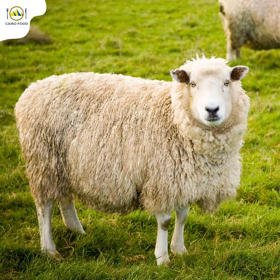
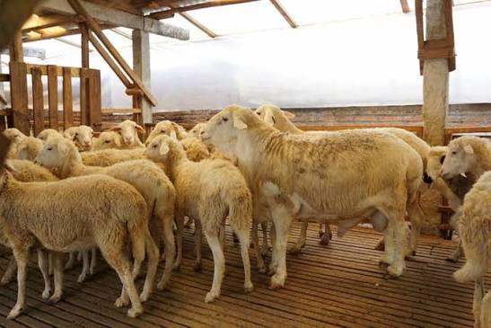
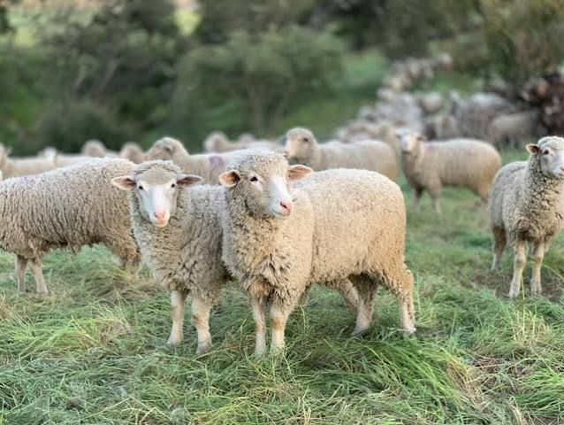
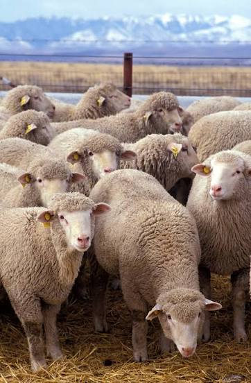

# Perbedaan Karakter Domba Dorper, Cross Texel, dan Merino

Domba merupakan salah satu jenis ternak yang memiliki banyak ras dengan karakteristik berbeda. Setiap jenis domba mempunyai keunggulan masing-masing, mulai dari pertumbuhan tubuh, bentuk otot, kualitas bulu, hingga kemampuan beradaptasi dengan lingkungan.

Tiga jenis domba yang cukup menarik untuk dipelajari adalah **Dorper**, **Cross Texel**, dan **Merino**. Ketiganya memiliki ciri khas yang dapat menjadi pertimbangan bagi peternak sebelum memilih bibit atau mengembangkan usaha peternakan.

Lalu, apa perbedaan domba Dorper, Cross Texel, dan Merino? Mari kita bahas dengan bahasa sederhana agar lebih mudah dipahami.

---

## 1. Mengenal Domba Dorper

Domba Dorper berasal dari Afrika Selatan. Jenis ini dikembangkan untuk menghasilkan daging berkualitas dengan kemampuan beradaptasi di lingkungan yang relatif kering.

Salah satu keunggulan domba Dorper adalah pertumbuhan tubuh dan perkembangan ototnya. Domba ini dikenal memiliki tubuh berisi, bagian punggung yang lebar, serta bagian paha yang berotot. Karakter tersebut membuat Dorper banyak dikembangkan sebagai domba pedaging.

Selain itu, Dorper memiliki kemampuan merontokkan bulu secara alami sehingga kebutuhan pencukuran bulunya relatif lebih rendah dibandingkan domba berbulu wol yang perlu dicukur secara rutin.

Domba Dorper juga dikenal cukup mudah beradaptasi dengan berbagai kondisi lingkungan. Namun, kemampuan adaptasi tersebut tetap bergantung pada kualitas pakan, kebersihan kandang, ketersediaan air, dan perawatan sehari-hari.

### Karakter utama domba Dorper:
* Memiliki tubuh berisi dan berotot.
* Cocok dikembangkan untuk produksi daging.
* Mempunyai kemampuan merontokkan bulu secara alami.
* Dapat beradaptasi dengan beragam kondisi lingkungan.
* Berpotensi menjadi pilihan untuk usaha pembibitan maupun penggemukan.

Dorper dapat menjadi pilihan bagi peternak yang berfokus pada produksi daging dan menginginkan ternak dengan kebutuhan perawatan bulu yang relatif rendah.

---

## 2. Mengenal Domba Cross Texel

Domba Cross Texel merupakan domba hasil persilangan yang melibatkan ras Texel dengan ras domba lainnya. Karena merupakan hasil persilangan, karakteristiknya dapat berbeda-beda tergantung pada jenis induk dan pejantan yang digunakan.

Ras Texel berasal dari Pulau Texel di Belanda. Domba ini dikenal memiliki bentuk tubuh yang kuat, punggung panjang, serta perkembangan otot yang baik. Karakter tersebut menjadikan Texel populer dalam program persilangan untuk menghasilkan domba pedaging.

Pada domba Cross Texel, bentuk tubuh dan tingkat perkembangan otot dapat dipengaruhi oleh persentase darah Texel serta sifat yang diwariskan dari induknya. Oleh karena itu, tidak semua Cross Texel mempunyai penampilan atau pertumbuhan yang sama.

Secara umum, domba Cross Texel yang memiliki bentuk tubuh baik dapat menunjukkan punggung yang cukup lebar, badan yang panjang, dan paha yang berisi. Namun, penilaian tetap perlu dilakukan pada masing-masing individu, bukan hanya berdasarkan nama persilangannya.

### Karakter utama domba Cross Texel:
* Berpotensi memiliki perkembangan otot yang baik.
* Dapat mempunyai bentuk tubuh panjang dan kokoh.
* Karakter fisiknya dipengaruhi oleh kombinasi genetik kedua induk.
* Cocok dipertimbangkan untuk program persilangan dan produksi daging.
* Memerlukan pemilihan bibit yang tepat agar hasil pemeliharaan sesuai tujuan.

Bagi peternak, Cross Texel menarik untuk dipertimbangkan ketika ingin mengembangkan domba dengan karakter tubuh yang mendukung produksi daging. Pastikan asal-usul persilangan dan kondisi ternak diketahui sebelum membeli.

---

## 3. Mengenal Domba Merino

Domba Merino dikenal luas sebagai salah satu ras penghasil wol berkualitas tinggi. Ras ini memiliki sejarah panjang dalam industri wol dan dikembangkan di berbagai negara, termasuk Australia.

Ciri yang paling menonjol dari Merino adalah bulunya yang lebat, halus, dan tumbuh menutupi sebagian besar tubuh. Berbeda dengan Dorper yang dapat merontokkan bulunya secara alami, domba Merino umumnya membutuhkan pencukuran wol secara berkala.

Meskipun terkenal sebagai domba penghasil wol, Merino juga dapat dimanfaatkan untuk produksi daging. Kemampuan tersebut bergantung pada jenis Merino, garis keturunan, serta sistem pemeliharaannya.

Karakter Merino juga tidak selalu sama. Beberapa tipe dikembangkan untuk menghasilkan wol yang sangat halus, sedangkan tipe lainnya mempunyai ukuran tubuh lebih besar dan produksi wol yang berbeda.

### Karakter utama domba Merino:
* Memiliki bulu wol yang lebat dan halus.
* Dikenal sebagai domba penghasil wol berkualitas.
* Membutuhkan pencukuran wol secara berkala.
* Karakter tubuh dan produksi wol bervariasi menurut garis keturunannya.
* Dapat dikembangkan untuk usaha wol maupun sistem produksi wol dan daging.

Merino lebih tepat dipertimbangkan oleh peternak yang mempunyai tujuan produksi wol atau ingin mempelajari sistem peternakan domba berbasis wol.

---

## 4. Tabel Perbedaan Domba Dorper, Cross Texel, dan Merino

Agar lebih mudah membandingkan ketiganya, berikut ringkasan karakteristik masing-masing jenis domba:

| Karakteristik | Dorper | Cross Texel | Merino |
| :--- | :--- | :--- | :--- |
| **Asal ras** | Afrika Selatan | Persilangan yang melibatkan Texel | Berasal dari garis keturunan Merino, yang berkembang di berbagai negara |
| **Keunggulan utama** | Produksi daging | Potensi bentuk tubuh dan otot | Produksi wol |
| **Bentuk tubuh** | Umumnya berisi dan berotot | Bervariasi, berpotensi panjang dan berotot | Bervariasi menurut tipenya |
| **Karakter bulu** | Cenderung merontokkan bulu secara alami | Bergantung pada hasil persilangan | Umumnya lebat dan berbulu wol |
| **Perawatan bulu** | Relatif rendah | Bergantung pada karakter bulunya | Umumnya memerlukan pencukuran berkala |
| **Tujuan pemeliharaan** | Daging dan pembibitan | Persilangan dan produksi daging | Wol, atau wol dan daging |
| **Hal penting saat memilih** | Pertumbuhan, kesehatan, dan bentuk tubuh | Komposisi persilangan dan performa ternak | Kualitas wol, kondisi tubuh, dan tujuan usaha |

> **Catatan Penting:** Perlu dipahami bahwa tabel tersebut merupakan gambaran umum. Performa setiap domba dapat berbeda karena faktor genetik, umur, jenis kelamin, pakan, kesehatan, dan lingkungan pemeliharaan.

---

## 5. Mana yang Lebih Cocok untuk Usaha Peternakan?

Memilih domba sebaiknya tidak hanya berdasarkan penampilan atau ukuran tubuh. Peternak perlu menentukan tujuan usaha terlebih dahulu agar jenis ternak yang dipilih sesuai dengan kebutuhan.

### Jika fokus pada produksi daging
Dorper dapat menjadi salah satu pilihan karena dikembangkan untuk produksi daging, memiliki perkembangan otot yang baik, dan relatif rendah kebutuhan perawatan bulunya.

Cross Texel juga layak dipertimbangkan, terutama jika hasil persilangannya menunjukkan pertumbuhan dan bentuk tubuh yang sesuai dengan target produksi.

### Jika fokus pada persilangan dan pembibitan
Dorper dan Cross Texel dapat dipertimbangkan sebagai bagian dari program pembibitan. Namun, pemilihan induk dan pejantan sebaiknya memperhatikan riwayat keturunan, kesuburan, pertumbuhan, kesehatan, serta kemampuan beradaptasi.

Jangan hanya mengandalkan nama ras. Catatan performa ternak dan kualitas induk-pejantan lebih membantu dalam menentukan keberhasilan pembibitan.

### Jika fokus pada produksi wol
Merino merupakan pilihan yang lebih relevan karena dikenal dengan kualitas wolnya. Peternak perlu memperhitungkan kebutuhan pencukuran, penanganan wol, kondisi lingkungan, dan peluang pasar sebelum menjalankan usaha berbasis wol.

### Bagaimana dengan kondisi peternakan di Indonesia?
Di Indonesia, peternak perlu memperhatikan suhu lingkungan, kelembapan, ventilasi kandang, ketersediaan pakan, dan pengendalian parasit. Domba yang berasal dari lingkungan berbeda tetap memerlukan penyesuaian terhadap kondisi pemeliharaan setempat.

Tidak ada satu jenis domba yang otomatis paling menguntungkan untuk semua peternak. Keuntungan usaha dipengaruhi oleh harga bibit, biaya pakan, tingkat pertumbuhan, kesehatan ternak, angka kelahiran, dan harga jual di pasar.

---

## 6. Tips Memilih Bibit Domba yang Berkualitas

Sebelum membeli Dorper, Cross Texel, maupun Merino, ada beberapa hal yang perlu diperhatikan:

1. **Periksa kondisi kesehatan:** Pilih domba yang aktif, memiliki mata jernih, dan tidak menunjukkan tanda sakit.
2. **Amati bentuk tubuh:** Sesuaikan bentuk tubuh dengan tujuan pemeliharaan, baik untuk pedaging maupun pembibitan.
3. **Perhatikan umur dan pertumbuhan:** Bandingkan ukuran tubuh dengan umur ternak agar penilaian lebih objektif.
4. **Tanyakan asal-usul ternak:** Khusus Cross Texel, cari tahu jenis persilangan dan informasi induk-pejantannya jika tersedia.
5. **Periksa kaki dan cara berjalan:** Kaki yang kuat membantu ternak bergerak dan mencari pakan dengan baik.
6. **Sesuaikan dengan kemampuan pemeliharaan:** Pertimbangkan kebutuhan pakan, kandang, tenaga kerja, dan perawatan bulu.
7. **Bandingkan harga dengan kualitas:** Harga yang lebih tinggi tidak selalu menjamin performa terbaik. Perhatikan kondisi dan catatan ternaknya.

Dengan melakukan pemeriksaan tersebut, peternak dapat membuat keputusan pembelian yang lebih terarah dan mengurangi risiko memilih ternak yang tidak sesuai dengan tujuan usaha.

---

## Kesimpulan

Domba Dorper, Cross Texel, dan Merino mempunyai karakteristik yang berbeda. Dorper dikenal karena potensinya dalam produksi daging dan kemampuan merontokkan bulu secara alami. Cross Texel merupakan hasil persilangan yang dapat memiliki bentuk tubuh dan perkembangan otot yang baik, tergantung pada kombinasi genetiknya. Sementara itu, Merino terkenal sebagai penghasil wol berkualitas.

Sebelum menentukan pilihan, peternak perlu mempertimbangkan tujuan usaha, kondisi lingkungan, biaya pemeliharaan, dan kualitas individu ternak. Dengan pemilihan bibit serta perawatan yang tepat, usaha peternakan dapat dikembangkan sesuai kebutuhan dan kemampuan masing-masing peternak.

---

### Ingin mengenal pilihan domba untuk usaha peternakan?

Kunjungi halaman [Jual Beli Domba Dombastis](https://www.peternakandomba.web.id/layanan.html#jual-beli) untuk melihat informasi layanan dan pilihan ternak yang tersedia. Pastikan untuk menanyakan ketersediaan, jenis, serta kondisi ternak sebelum melakukan pembelian.

---

## Referensi

* Dorper Sheep Society of Australia. *Why Dorpers?*  
  [https://www.dorper.com.au/attributes/](https://www.dorper.com.au/attributes/)
* British Texel Sheep Society. *Texel Breed Description.*  
  [https://texel.uk/texel-breed-description/](https://texel.uk/texel-breed-description/)
* Australian Association of Stud Merino Breeders. *The Merino.*  
  [https://merinos.com.au/the-merino/](https://merinos.com.au/the-merino/)
* National Museum of Australia. *Merino Sheep Introduced.*  
  [https://www.nma.gov.au/defining-moments/resources/merino-sheep-introduced](https://www.nma.gov.au/defining-moments/resources/merino-sheep-introduced)

*Referensi tersebut digunakan untuk menjelaskan karakter umum setiap ras. Informasi mengenai Cross Texel perlu ditafsirkan secara hati-hati karena hasil persilangan tidak selalu mempunyai karakter yang seragam.*
